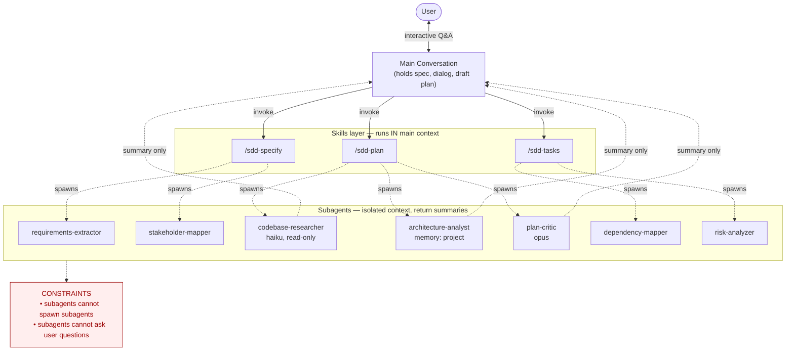

# Claude Code: Skills and Subagents for Spec-Driven Development

A summary of how Claude Code's two main extensibility primitives — skills and subagents — compose, what `context: fork` actually means, and how to structure a spec-driven-development (SDD) workflow on top of them.

---

## Part 1 — High-Level Summary

Claude Code gives you two primitives that look similar (both are Markdown files with YAML frontmatter, both invocable via `/`) but solve different problems:

- **Skills** are prompt fragments that load into the **current conversation's context window**. They add knowledge, methodology, or step-by-step procedures that the main thread executes. Once invoked, a skill's content stays in context for the rest of the session.
- **Subagents** spawn a **separate Claude instance** with its own context window, its own system prompt, and its own tool/permission profile. They work independently and return only a summary to the caller.

Two constraints define how they must compose:

1. **A subagent cannot spawn another subagent.** There is exactly one level of nesting available.
2. **A subagent cannot ask the user questions.** The `AskUserQuestion` tool is denied to subagents.

The practical consequence is a layering rule that applies to almost every non-trivial workflow:

> Any layer that needs to (a) talk to the user, or (b) delegate further, must be a **skill** or the **main thread**. **Subagents go at the bottom** as isolated workers.

For SDD this maps directly: the three phases (`/sdd-specify`, `/sdd-plan`, `/sdd-tasks`) are **skills** — they are user-invokable, they drive interactive dialog, and they need to dispatch investigations. The investigations themselves (codebase reconnaissance, architecture analysis, plan critique, dependency mapping, etc.) are **subagents** — high-volume, one-shot work that should not pollute the main context.

`context: fork` is a separate mechanism that lets a skill run in an isolated subagent context. It is useful for individual heavy operations within a phase, but it cannot replace the orchestrator role of the top-level skills, because forked skills inherit the same nesting and Q&A limits as any other subagent.

---

## Architecture diagram



---

## Part 2 — Details

### Skills

A skill is a directory containing at least `SKILL.md`. Locations follow a precedence chain: enterprise (managed settings) overrides personal (`~/.claude/skills/`), which overrides project (`.claude/skills/`). Plugin skills are namespaced as `plugin-name:skill-name`. Project skills also load from any parent directory up to the repo root, and on-demand from nested `.claude/skills/` when working in subdirectories — important for monorepos.

**Key frontmatter fields:**

- `description` and `when_to_use` — drive auto-invocation; combined text is capped at 1,536 characters in the skill listing.
- `disable-model-invocation: true` — only the user can call it via `/name`; useful for destructive operations like `/deploy` or `/commit`.
- `user-invocable: false` — inverse: Claude can call it, but it doesn't show in the `/` menu. Good for background-knowledge skills.
- `allowed-tools` / `disallowed-tools` — pre-approve or remove tools while the skill is active.
- `model` and `effort` — override the session model/effort for the rest of the current turn only (not persistent).
- `paths` — glob patterns; the skill auto-loads only when working with matching files.
- `context: fork` and `agent: <type>` — run the skill in an isolated subagent context (see below).
- `hooks` — lifecycle hooks scoped to this skill.
- `arguments` / `argument-hint` / `$ARGUMENTS` / `$N` — positional argument substitution into the skill body.

**Dynamic context injection.** The `` !`<command>` `` syntax runs a shell command *before* the skill content is sent to Claude; the command output replaces the placeholder. This is preprocessing, not tool use. A `/pr-summary` skill can run `gh pr diff` at expansion time so the model starts with the live PR state inlined, rather than burning tool-call turns to fetch it.

**Lifecycle.** Once a skill loads, its content stays in context for the rest of the session. Claude Code does not re-read the file on later turns, so guidance must be written as standing instructions. During auto-compaction, the most recent invocation of each skill is re-attached after the summary (first 5,000 tokens of each, shared 25,000-token budget, filled most-recent backward).

### Subagents

Subagents live in `.claude/agents/` (project), `~/.claude/agents/` (user), inside plugins, or are passed inline via `--agents` JSON.

**Built-in subagents:**

- **Explore** — Haiku, read-only, optimized for file discovery and codebase search. Skips CLAUDE.md and git status to stay cheap.
- **Plan** — inherits the main conversation's model, read-only, used during plan mode.
- **general-purpose** — full toolset, used for complex multi-step work needing both exploration and modification.
- **statusline-setup** and **claude-code-guide** — auto-invoked helpers.

**Key frontmatter fields:**

- `model` — `sonnet`, `opus`, `haiku`, a full model ID like `claude-opus-4-7`, or `inherit`.
- `tools` / `disallowedTools` — `disallowedTools` is applied first, then `tools` resolves against the remainder.
- `permissionMode` — `default`, `acceptEdits`, `auto`, `dontAsk`, `bypassPermissions`, `plan`.
- `skills` — preloaded skills (full content injected at startup, not just description).
- `mcpServers` — scoped MCP servers, either by name or inline definition.
- `memory` — `user`, `project`, or `local`; gives the subagent a persistent directory under `.claude/agent-memory/<name>/` with a curated `MEMORY.md` loaded at startup.
- `background: true` — always run concurrently.
- `isolation: worktree` — run in a temporary git worktree branched from your default branch.
- `initialPrompt` — auto-submitted first user turn when the agent runs as the main session via `--agent`.

**Two modes of execution.** An agent definition can run in two distinct modes:

1. **As a subagent**, spawned by the main thread. Cannot spawn further subagents, cannot ask user questions.
2. **As the main session**, launched via `claude --agent <name>`. Is the main thread — has full Q&A capability and can spawn subagents freely.

### `context: fork` — the two meanings

The word "fork" appears in two places and refers to different things:

| Mechanism | What it does | Inherits parent history? |
|---|---|---|
| `/fork` command (experimental, requires `CLAUDE_CODE_FORK_SUBAGENT=1`) | Spawns a subagent that inherits the entire parent conversation. Tool calls stay isolated; only final result returns. | Yes |
| `context: fork` in skill frontmatter | Runs the skill in an isolated subagent. The skill body becomes the subagent's prompt. | No |

Despite the shared name, `context: fork` is *not* like the `/fork` command — it starts fresh, not inherited. The `agent: <type>` field picks which subagent configuration runs the skill (`Explore`, `Plan`, `general-purpose`, or any custom subagent). If omitted, `general-purpose` is used.

`context: fork` only makes sense for skills with explicit, actionable instructions. A reference-style skill ("use these API conventions") forked into a subagent just dumps guidelines with no task to act on.

### Composition: skills with subagents, subagents with skills

The two primitives compose in both directions:

| Approach | System prompt | Task source | Also loads |
|---|---|---|---|
| Skill with `context: fork` | From the chosen agent type | The SKILL.md content | CLAUDE.md (except Explore/Plan) |
| Subagent with `skills:` field | The subagent's markdown body | Claude's delegation message | Preloaded skill content + CLAUDE.md |

Rule of thumb: build a subagent when you're creating a new specialist; use `context: fork` when you already have a skill and want to run it in isolation without duplicating it.

Important difference for the `skills:` field on a subagent: the **full skill content** is injected at startup, not just the description. Be selective — preloading large skills into every subagent invocation is a recurring token cost.

---

## Applied to Spec-Driven Development

### The recommended structure

Three SDD phase skills at the top, supporting subagents below:

```
Main thread (interactive, holds dialog + deliverable)
│
├─ /sdd-specify  (skill — methodology for specification phase)
│     └─ may spawn: requirements-extractor, stakeholder-mapper
│
├─ /sdd-plan     (skill — methodology for planning phase)
│     └─ may spawn: codebase-researcher, architecture-analyst, plan-critic
│
└─ /sdd-tasks    (skill — methodology for task breakdown)
      └─ may spawn: dependency-mapper, estimator, risk-analyzer
```

### Why phases must be skills, not subagents

Three reasons make the inversion (phases as subagents) wrong:

1. **No nested delegation.** A subagent cannot spawn other subagents. If `sdd-plan` is a subagent, you have burned the one available nesting level — the codebase-researcher and friends become unreachable from inside it.
2. **No user dialog.** The plan phase is inherently a Q&A loop. Subagents cannot call `AskUserQuestion`; they can only return one final report.
3. **Ergonomics.** `/sdd-specify`, `/sdd-plan`, `/sdd-tasks` are exactly what user-invocable skills are for.

### Why investigations should be subagents

Plan-phase investigations (mapping current code, reading architecture docs, analyzing dependencies) generate verbose intermediate output — file contents, grep results, doc excerpts — that the main thread will never reference again after extracting the conclusion. Subagents keep that volume out of the main context. The main conversation should end up containing the spec, the user Q&A rounds, the evolving plan, and short subagent digests — not file dumps.

### Patterns worth using

- **Parallel investigation.** Spawn several subagents concurrently for independent questions ("map orders module", "map payment integration", "list event consumers"). Wall-clock time matters during interactive planning.
- **Persistent memory for the architecture analyst.** With `memory: project`, the subagent accumulates "what we learned about this codebase" across all planning sessions in the repo. Subsequent plans start smarter.
- **Plan critic as a final pass.** A separate subagent (Opus, read-only) reviews the draft plan against the spec and flags gaps before you finalize.
- **`/btw` for tangential questions.** Mid-plan side-thoughts ("does our pipeline support feature flags?") answered without polluting history — the exchange is discarded.
- **Fork mode for parallel "what-if" approaches.** With `CLAUDE_CODE_FORK_SUBAGENT=1`, `/fork explore the event-sourcing approach` while the main thread continues with the synchronous approach. Both inherit current context; neither pollutes the other.

### When agents at the top would make sense

The one legitimate place for an agent at the top of an SDD workflow is as a **session-launch profile**: defining `sdd-plan-mode` as an agent so a teammate runs `claude --agent sdd-plan-mode` and gets a session with the right system prompt, model, and tool restrictions for plan work. From inside that session, the agent *is* the main thread — it calls the `/sdd-plan` skill and spawns investigators. This is orthogonal to the skill layer, not a replacement.

For most teams this is overkill. Start with skills for the phases and subagents for the capabilities, and promote to an `--agent` launch profile only if you find yourself always wanting a specific session mode.

---

## Primary references

- Skills: https://code.claude.com/docs/en/skills
- Subagents: https://code.claude.com/docs/en/subagents
- Hooks: https://code.claude.com/docs/en/hooks
- Plugins: https://code.claude.com/docs/en/plugins
- Agent Teams: https://code.claude.com/docs/en/agent-teams
