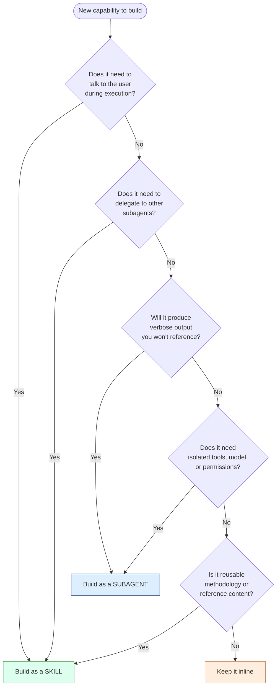

# Writing Skills and Subagents in Claude Code — Best Practices (v2)

A practical reference for designing skills, subagents, and their composition. The focus is on principles that apply across workflows; specific scenarios (spec-driven development, code review pipelines, deep research, multi-agent coordinators) are used as illustrative examples.

> **Changes from v1:** clearer mental model (knowledge layer vs execution layer; specialist-coworker vs library), expanded multi-agent orchestration coverage including the `Agent(worker1, worker2)` tool restriction for coordinator subagents, a new pattern for shared convention skills as DRY knowledge across multiple subagents, and a brief distinction between standard subagents and the experimental Agent Teams feature.

---

## The mental model

Claude Code gives you two extensibility primitives. They look similar (both are Markdown files with YAML frontmatter, both invocable via `/`) but they live in different places:

- **Skills** load content into the **current conversation's context window**. They are prompt fragments — knowledge, methodology, or step-by-step procedures — that the active thread executes inline.
- **Subagents** spawn a **separate Claude instance** with its own context, system prompt, tools, and permissions. They work independently and return only a summary.

### Two ways to frame the relationship

The two framings below say the same thing from different angles. Use whichever helps you decide faster.

**Specialist coworker vs library:** A subagent is a specialist coworker with their own workspace, tools, and instructions. A skill is a library or procedure that any coworker — including the main thread — can consult. When you assign work, you pick the right coworker (subagent) and they reach for the right book (skill).

**Knowledge layer vs execution layer:** Skills are the *knowledge and process layer* — conventions, checklists, methodologies, reusable procedures. Subagents are the *execution layer* — isolated workers with the right model, tools, and permissions to actually do the work. The two compose: an execution-layer subagent reaches into the knowledge layer (via preloaded `skills:` or via the Skill tool at runtime) to get the standards it should follow.

This framing has a practical payoff: when team conventions live in skills, you don't duplicate them across every subagent. One `api-conventions` skill is the source of truth; `api-developer`, `api-reviewer`, and `api-tester` subagents all preload it. Change the skill, every subagent updates.

### Two constraints that drive every design decision

1. **A subagent cannot spawn another subagent.** Exactly one level of nesting is available.
2. **A subagent cannot ask the user questions.** The `AskUserQuestion` tool is denied.

These yield the single most important architectural rule:

> Any layer that needs to (a) talk to the user, or (b) delegate further, must be a **skill** running in the main thread (or the main thread itself). **Subagents go at the bottom** as isolated workers that return digests.

---

## Decision: skill or subagent?



**Choose a skill** when the work is methodology, repeated procedure, reference knowledge, or anything the user types `/` to invoke. Skills are right when the operation involves dialog, iteration, or further delegation.

**Choose a subagent** when the work produces output you don't want in your main context (logs, file dumps, search results), requires a different model/tool/permission profile, or runs in parallel with other work.

**Keep it inline** when it's a one-time operation that doesn't repeat across sessions.

---

## Rules for writing good skills

### 1. The description is everything

For auto-invocation, Claude reads the `description` (plus optional `when_to_use`) to decide when to load the skill. The combined text is capped at 1,536 characters in the skill listing, and only the description is in context by default — the body loads on demand.

Lead with the trigger condition, not the implementation. "Use when the user asks to commit changes, finalize a PR, or wants to publish work" is better than "Manages git commits using conventional commit format."

If the skill is for manual invocation only, mark it `disable-model-invocation: true` so it doesn't compete for attention in the listing.

### 2. Keep the body concise

Once a skill loads, every line of its body is a recurring token cost across all subsequent turns. State what to do, not why or how. Apply the same conciseness test you'd apply to CLAUDE.md content.

The official guideline is to keep `SKILL.md` under 500 lines and move detailed reference material to separate files in the skill directory, referenced from `SKILL.md` so Claude knows when to load them.

### 3. Use dynamic context injection for live data

The `` !`command` `` syntax runs a shell command *before* the skill content is sent to Claude; the output replaces the placeholder. This is preprocessing, not a tool call.

A `/pr-review` skill can inline `gh pr diff`, `gh pr view --comments`, and `git log --oneline main..HEAD` at expansion time — Claude starts with the live data already in the prompt rather than burning tool-call turns to fetch it. The same pattern works for `kubectl get pods`, `npm outdated`, `terraform plan`, or any command whose output the skill would otherwise have to ask Claude to gather.

### 4. Choose invocation control deliberately

| Frontmatter | User invokes via `/` | Claude auto-invokes | Use for |
|---|---|---|---|
| (default) | Yes | Yes | General-purpose workflows |
| `disable-model-invocation: true` | Yes | No | Destructive actions: `/deploy`, `/commit`, `/release` |
| `user-invocable: false` | No | Yes | Background reference: `legacy-system-context`, coding conventions |

Anything that has side effects (deploys, commits, external API calls, sends messages) should be `disable-model-invocation: true`. You don't want Claude deciding the code "looks ready" and triggering a deploy.

### 5. Pre-approve tools narrowly

`allowed-tools` grants permission without per-use prompting while the skill is active. Be specific:

```yaml
allowed-tools: Bash(git add *) Bash(git commit *) Bash(git status *)
```

is correct. `allowed-tools: Bash` is a security hole.

### 6. Use arguments instead of free-text instructions

Skills support `$ARGUMENTS`, `$0`, `$1`, named `$name` arguments, and `argument-hint` for autocomplete. A `/migrate $0 $1 $2` skill is clearer and more reliable than a skill that asks Claude to "parse the user's request."

### 7. Use `paths` for auto-loading when relevant

The `paths` field (glob patterns) makes a skill auto-load only when working with matching files. A `react-component-conventions` skill scoped to `**/*.tsx` won't clutter the listing when you're editing Python.

### 8. Decide whether the skill is reference or task content

- **Reference content** (style guides, conventions, domain knowledge) runs inline so Claude can apply it alongside other work. No `context: fork`.
- **Task content** (deployments, scaffolding, specific multi-step actions) often makes more sense with `disable-model-invocation: true` and possibly `context: fork` to run in isolation.

Don't fork reference skills — they need to influence the main thread, not run separately.

### 9. Test that the skill survives compaction

Skills are re-attached after auto-compaction with the first 5,000 tokens of each invocation, sharing a 25,000-token combined budget. If your skill's first 5,000 tokens don't capture the standing instructions, the post-compaction behavior will degrade. Put the actionable rules at the top, examples and elaboration after.

---

## Rules for writing good subagents

### 1. One specialty per subagent

A subagent should excel at one thing: code review, security analysis, test running, dependency mapping, log analysis. Resist building "do-everything" subagents — Claude can compose specialists, but it can't decompose generalists.

Vague descriptions like "helps with various tasks" don't drive good auto-delegation. "Reviews code changes for security issues, focusing on injection risks, auth bypasses, and secret exposure" does.

### 2. Restrict tools to the minimum

A reviewer that only needs to read code should not have `Edit` or `Write`. Use `tools:` as an allowlist or `disallowedTools:` as a denylist; `disallowedTools` is applied first, then `tools` resolves against the remainder.

For read-only investigators, `permissionMode: plan` adds a belt-and-suspenders guarantee against accidental writes.

### 3. Choose the model deliberately

The `model` field is one of the highest-leverage decisions:

| Model | Good for |
|---|---|
| `haiku` | High-volume read, search, classification, file listing |
| `sonnet` | General-purpose work, code review, refactoring, most development tasks |
| `opus` | Complex reasoning, architecture decisions, critical-path review |
| `inherit` | When you want behavior to follow whatever the user picked for the session |

A typical setup might run a `bulk-searcher` on Haiku (cheap, fast, parallel), a `code-reviewer` on Sonnet (balanced), and a `architecture-critic` on Opus (used sparingly for high-stakes review).

The resolution order at runtime is: `CLAUDE_CODE_SUBAGENT_MODEL` env var → per-invocation `model` parameter → definition frontmatter → main conversation. You can override at runtime without touching the file.

### 4. Use memory for accumulated knowledge

The `memory` field (`user`, `project`, or `local`) gives the subagent a persistent directory with a curated `MEMORY.md` that loads at startup. Use it when the subagent's value compounds across sessions:

- A `code-reviewer` with `memory: project` accumulates a "things this team gets wrong" file
- A `debugger` with `memory: project` builds a known-pitfalls index
- A `db-analyst` with `memory: project` remembers the schema's quirks

`project` is the recommended default — knowledge is shareable via version control. Use `local` for sensitive or noisy notes that shouldn't be committed.

Include explicit memory-maintenance instructions in the subagent body:

```markdown
Read MEMORY.md before starting. After completing the task, update MEMORY.md
with: new patterns you observed, recurring issues, architectural decisions
referenced. Keep notes concise and dated. Curate aggressively if it exceeds
200 lines.
```

### 5. Use `isolation: worktree` for risky work

Setting `isolation: worktree` runs the subagent in a temporary git worktree branched from your default branch. The worktree is auto-cleaned if the subagent makes no changes. Use this for:

- Bulk refactoring subagents that might break the build
- Migration agents that touch many files
- Experiments where you want to review the diff before merging

### 6. Use hooks for deterministic enforcement

When tool-level restrictions aren't fine-grained enough, `PreToolUse` hooks let you validate operations before they run. A common pattern is a `db-reader` subagent that has `Bash` access but uses a hook to block SQL write operations:

```yaml
hooks:
  PreToolUse:
    - matcher: "Bash"
      hooks:
        - type: command
          command: "./scripts/validate-readonly-query.sh"
```

The hook exits with code 2 to block and pass an error message back to Claude. This is more reliable than prompt-level instructions ("only run SELECT queries") because it cannot be circumvented by the model.

### 7. Write a description that drives delegation

Claude uses the description to decide when to delegate automatically. Include phrases like "use proactively after code changes" or "invoke when encountering test failures" to encourage delegation. Be specific about *when* and *why*, not just *what*.

Also include in the body what the subagent should output and in what format. Subagents are at the end of their context line — they can't ask you to "format this differently." Specify upfront: "Return findings as a markdown table with columns: Severity, File, Line, Issue, Recommended Fix."

### 8. Don't preload large skills into subagents

The `skills:` field injects the **full content** of each listed skill at startup, not just the description. Preloading a 3,000-line reference skill into every invocation is expensive. Preload only when:

- The skill is small (under a few hundred lines)
- The subagent genuinely needs the content as standing instructions, not on-demand reference

For larger reference material, let the subagent discover and invoke skills through the Skill tool during execution, or pass relevant excerpts inline through the delegation message.

### 9. Use `Agent()` restrictions for coordinator agents

When an agent runs as the main thread (via `claude --agent <name>`), it can spawn subagents. To restrict *which* subagents it can spawn, use the `Agent(name1, name2)` syntax in the `tools` list:

```yaml
---
name: release-coordinator
description: Coordinates release workflows by delegating to specific workers
tools: Agent(changelog-writer, version-bumper, release-notes-publisher), Read, Bash
model: sonnet
---
```

This is an allowlist — the coordinator can only spawn the listed workers. `Agent` without parentheses allows spawning any subagent; omitting `Agent` entirely blocks all spawning. This matters because it makes coordinator behavior deterministic: you know exactly which workers can be invoked, and you can audit the workflow surface.

Note that this restriction only applies when the agent runs as the main thread. Subagents cannot spawn other subagents, so `Agent(...)` in a regular subagent definition has no effect.

---

## Composition patterns

### Pattern 1: Skill orchestrates parallel subagents

The main thread runs a skill that fans out independent investigations. Used for any phase that needs to gather evidence from multiple sources before synthesizing.

**Example (SDD plan phase):** `/sdd-plan` spawns `codebase-researcher`, `architecture-analyst`, and `dependency-mapper` in parallel; collects digests; formulates user questions; drafts plan.

**Example (security audit):** `/security-audit` spawns `auth-flow-analyzer`, `dependency-scanner`, and `secret-scanner` in parallel; aggregates findings.

### Pattern 2: Skill chains sequential subagents

When investigations depend on each other, chain them — each subagent's output informs the next.

**Example (refactor preparation):** `/prepare-refactor` runs `usage-mapper` to find call sites, then passes that list to `impact-analyzer` to assess blast radius, then to `test-coverage-checker` to identify gaps.

### Pattern 3: Skill with `context: fork` for one-off isolation

When a skill itself is expensive and you don't want its execution polluting main context, add `context: fork`. The skill body becomes the subagent's prompt.

**Example:** A `/codebase-map` skill that reads dozens of files to produce a structural summary — `context: fork agent: Explore` gives it Haiku speed and read-only safety, and only the summary returns.

**Caveat:** Only do this for skills with explicit, actionable instructions. A reference-style skill ("use these conventions") with `context: fork` produces nothing useful — the subagent has guidelines but no task.

### Pattern 4: Convention skills shared across multiple subagents (DRY knowledge)

Encode team conventions, style guides, and domain rules as **dedicated skills**, then have multiple specialist subagents preload them. This is the practical realization of the knowledge-layer / execution-layer framing — and it's how you avoid duplicating the same conventions across every subagent file.

**Example structure:**

```
.claude/skills/
├── api-conventions/SKILL.md           # REST patterns, error formats, versioning
├── error-handling-patterns/SKILL.md   # logging, retries, circuit breakers
└── security-checklist/SKILL.md        # input validation, secret handling

.claude/agents/
├── api-developer.md      # preloads: api-conventions, error-handling-patterns
├── api-reviewer.md       # preloads: api-conventions, security-checklist
└── api-tester.md         # preloads: api-conventions
```

```yaml
---
name: api-reviewer
description: Reviews API endpoints for convention compliance and security issues
tools: Read, Grep, Glob
model: sonnet
skills:
  - api-conventions
  - security-checklist
---
Review API endpoints against the preloaded conventions and security checklist.
Report violations grouped by severity.
```

When the conventions evolve, you change one skill and every subagent that preloads it picks up the new version on next invocation. No copy-paste across agent files, no drift.

### Pattern 5: Coordinator agent with restricted worker pool

A coordinator runs as the main session (via `claude --agent`) and orchestrates a fixed set of workers using `Agent(worker1, worker2)` to lock down which subagents can be spawned. This is the pattern often called "meta agents" or "multi-agent workflows" in community write-ups.

**Example (release workflow):**

```yaml
---
name: release-coordinator
description: Orchestrates the release process across changelog, versioning, and publishing
tools: Agent(changelog-writer, version-bumper, release-notes-publisher), Read, Bash, Edit
model: sonnet
permissionMode: acceptEdits
---
You orchestrate releases. Phases:

1. Use `changelog-writer` to scan commits since the last release and draft a changelog entry.
2. Use `version-bumper` to update version files based on the changelog (major/minor/patch).
3. Confirm with the user before publishing.
4. Use `release-notes-publisher` to create the GitHub release.

Never edit version files directly — always delegate to `version-bumper`.
Always confirm with the user before phase 3.
```

Launched via `claude --agent release-coordinator`, the coordinator can ask the user questions (it's the main thread), spawn its three workers (via the `Agent()` allowlist), and read/edit files. Workers each have their own focused profile, model, and tools.

The pattern composes well with shared convention skills (Pattern 4): each worker preloads the relevant conventions, so the coordinator doesn't need to repeat them in delegation messages.

### Pattern 6: Subagent with preloaded skills as reference

When a single subagent always needs the same domain knowledge to do its job, preload via the `skills:` field. The full skill content is injected at startup.

**Example:** An `api-developer` subagent with `skills: [api-conventions, error-handling-patterns]` — every invocation starts with the team's API rules already in context.

Use sparingly; only when the subagent truly needs the content as standing instructions. See rule #8 for the cost trade-off.

### Pattern 7: Agent as session-launch profile

`claude --agent <name>` starts the entire session with that agent as the main thread. The agent's system prompt replaces the default Claude Code system prompt, and the agent's model and tool restrictions apply for the whole session.

**Example:** A `code-review-mode` agent launched via `claude --agent code-review-mode` for PR review sessions — read-only tools, Sonnet model, focused system prompt. From inside that session, the agent *is* the main thread, so it can ask questions, spawn subagents, and call skills freely.

This is orthogonal to your skill layer — `--agent` profiles set up the session, skills define workflows within it. Combined with Pattern 5, it's how you build coordinator-driven workflows.

---

## A note on Agent Teams vs subagents

Standard subagents and the experimental **Agent Teams** feature are different things, and the terminology in community write-ups sometimes blurs them.

| Mechanism | Communication | Status |
|---|---|---|
| **Subagents** | One-way: parent delegates, subagent returns a summary. No back-and-forth. | Stable |
| **Agent Teams** | Multi-way: agents can `SendMessage` to each other and resume each other's sessions. | Experimental, behind `CLAUDE_CODE_EXPERIMENTAL_AGENT_TEAMS=1` |

The patterns in this document use **standard subagents** — they're the right tool for most workflows. Agent Teams becomes relevant only when you need sustained parallelism across truly independent contexts, or workers that communicate iteratively rather than handing off once.

For the coordinator pattern (Pattern 5), standard subagents are usually enough: the coordinator (main thread) delegates, each worker returns a summary, the coordinator synthesizes and decides the next step. You only need Agent Teams when workers themselves need to talk to each other directly without going through the coordinator.

---

## Anti-patterns to avoid

### Building orchestrators as subagents

Symptom: A "workflow manager" subagent that tries to coordinate other subagents and gather user input. Doesn't work — subagents can't spawn subagents and can't ask the user questions. Promote it to a skill or a coordinator agent that runs as the main session.

### Bloated skill bodies

Symptom: A `SKILL.md` longer than a few hundred lines, with extensive examples and rationale inline. Every line is a recurring token cost. Move examples and reference material to supporting files in the skill directory; reference them from `SKILL.md` so Claude knows when to load them.

### Reference content with `context: fork`

Symptom: A `coding-conventions` skill marked `context: fork`. The forked subagent receives the conventions but no task to apply them to, and returns nothing useful. Reference skills should run inline; only task-oriented skills should fork.

### Duplicating conventions across subagent files

Symptom: The same API conventions, error handling rules, and security checklist pasted into the body of three different subagent files. When conventions change, you forget to update one and behavior drifts. Pull the conventions into shared skills (Pattern 4) and preload them.

### Subagents with overlapping purposes

Symptom: `code-reviewer`, `code-checker`, `code-analyzer`, `quality-reviewer` all subtly different. Claude's auto-delegation picks one essentially at random. Either consolidate into one, or sharpen descriptions so each has a clear, distinct trigger.

### Vague descriptions

Symptom: "This agent helps with database tasks." Doesn't tell Claude when to use it. Compare to: "Executes read-only SQL queries against the analytics warehouse to answer business questions. Use when the user asks for metrics, counts, or trends from production data."

### Granting too many tools

Symptom: Subagents that inherit all tools because `tools` was omitted. Defense in depth matters; a code reviewer with `Edit` access will eventually edit code by mistake. Be explicit.

### Unrestricted coordinator agents

Symptom: A coordinator agent with `tools: Agent` (no parentheses) that can spawn any subagent. Auto-delegation picks workers semi-randomly and the workflow becomes non-deterministic. Use `Agent(worker1, worker2, worker3)` to pin the allowed worker set.

### Preloading every skill into every subagent

Symptom: `skills: [conventions, patterns, examples, history, glossary, ...]` in a subagent frontmatter. The full content of each loads at startup, every invocation. Preload only what the subagent genuinely needs as standing instructions.

### Mistaking `/fork` for `context: fork`

These share a name but do different things:

| Mechanism | Inherits parent conversation? | Used for |
|---|---|---|
| `/fork` command (requires `CLAUDE_CODE_FORK_SUBAGENT=1`) | Yes — full history | Parallel "what if" exploration from current state |
| `context: fork` in skill frontmatter | No — starts fresh | Running a skill in an isolated subagent context |

Don't assume a forked skill has access to the conversation — it doesn't.

---

## Putting it together: a worked architecture

Here's how the patterns combine in practice. Say you have a large codebase with strong conventions (REST API rules, error handling, observability requirements) and you want Claude Code to help with API work end-to-end.

**Knowledge layer (skills):**

```
.claude/skills/
├── api-conventions/SKILL.md
├── error-handling-patterns/SKILL.md
├── observability-requirements/SKILL.md
└── api-test-conventions/SKILL.md
```

These are pure reference content — no `context: fork`, no destructive operations. Each is small, focused, and used by multiple downstream subagents.

**Execution layer (subagents):**

```
.claude/agents/
├── api-developer.md       # Sonnet, can edit, preloads: api-conventions, error-handling-patterns
├── api-reviewer.md        # Sonnet, read-only, preloads: api-conventions, observability-requirements
├── api-tester.md          # Sonnet, can edit tests only, preloads: api-conventions, api-test-conventions
└── api-architect.md       # Opus, read-only, preloads: api-conventions (used for design decisions)
```

Each subagent has the right model for its job, tool restrictions appropriate to its risk profile, and only the conventions it actually needs preloaded.

**Workflow layer (skills that orchestrate):**

```
.claude/skills/
├── new-endpoint/SKILL.md  # /new-endpoint — methodology: design with architect, implement with developer, review with reviewer, test with tester
└── api-audit/SKILL.md     # /api-audit — fans out reviewer + architect across the API surface, aggregates findings
```

These run in the main thread, drive the user dialog, and dispatch to the appropriate subagents in sequence or parallel.

**Optional coordinator (for end-to-end automation):**

```yaml
# .claude/agents/api-feature-coordinator.md
---
name: api-feature-coordinator
description: End-to-end API feature delivery from spec to merged PR
tools: Agent(api-architect, api-developer, api-reviewer, api-tester), Read, Edit, Bash
model: sonnet
permissionMode: default
---
```

Launched via `claude --agent api-feature-coordinator` for sessions dedicated to shipping a feature; the coordinator drives the workflow, the workers do the work, the conventions live once in the skills layer.

---

## Quick reference

### Skill frontmatter cheat sheet

```yaml
---
name: my-skill                          # Display name (defaults to directory)
description: When and why to use it     # Drives auto-invocation, cap 1536 chars
when_to_use: Additional trigger phrases # Appended to description
disable-model-invocation: false         # true = manual-only
user-invocable: true                    # false = hidden from / menu
allowed-tools: Read, Grep, Glob         # Pre-approved tools
disallowed-tools: Write, Edit           # Removed while skill is active
model: inherit                          # sonnet, opus, haiku, or full ID
effort: medium                          # low, medium, high, xhigh, max
context: fork                           # Run in isolated subagent
agent: Explore                          # Which agent type for fork
paths: "**/*.tsx, **/*.jsx"             # Auto-load only for matching files
arguments: [filename, format]           # Named positional args
argument-hint: "[filename] [format]"    # Autocomplete hint
hooks: { ... }                          # Lifecycle hooks
shell: bash                             # bash or powershell
---
```

### Subagent frontmatter cheat sheet

```yaml
---
name: my-subagent                       # Lowercase + hyphens, unique
description: When to delegate           # Drives auto-delegation
tools: Read, Grep, Glob, Bash           # Allowlist
                                        #   For coordinators: Agent(worker1, worker2)
disallowedTools: Write, Edit            # Denylist (applied first)
model: haiku                            # sonnet, opus, haiku, or full ID
effort: medium                          # Per-subagent effort override
permissionMode: plan                    # default, acceptEdits, auto, dontAsk, bypassPermissions, plan
maxTurns: 20                            # Stop after N agentic turns
skills: [conventions, patterns]         # Preloaded at startup (full content)
mcpServers: [github, slack]             # By name or inline definition
memory: project                         # user, project, local
background: false                       # true = always concurrent
isolation: worktree                     # Run in temporary git worktree
color: blue                             # Visual identifier in UI
initialPrompt: "First message"          # Auto-submitted when run via --agent
hooks: { ... }                          # PreToolUse, PostToolUse, Stop
---
```

### Layering rule

```
Main thread (can ask user, can spawn subagents)
├── Skills (run in main thread — same capabilities)
│   └── Spawn → Subagents (isolated, cannot ask user, cannot nest)
│
└── Direct subagent calls
    └── Subagents (same as above — leaf nodes)

Coordinator agent (= main thread when launched via `claude --agent`)
└── Restricted via Agent(worker1, worker2) → workers (subagents)
```

Anything that needs to talk to the user or delegate further must be at the top two levels.

### Knowledge layer vs execution layer

- **Knowledge layer:** skills that encode conventions, methodologies, reference material
- **Execution layer:** subagents that act with specific models, tools, and permissions
- **Composition:** subagents preload knowledge-layer skills via `skills:` (don't duplicate conventions across agent files)

---

## Primary references

- Skills: https://code.claude.com/docs/en/skills
- Subagents: https://code.claude.com/docs/en/subagents
- Hooks: https://code.claude.com/docs/en/hooks
- Plugins: https://code.claude.com/docs/en/plugins
- Agent Teams (experimental): https://code.claude.com/docs/en/agent-teams
